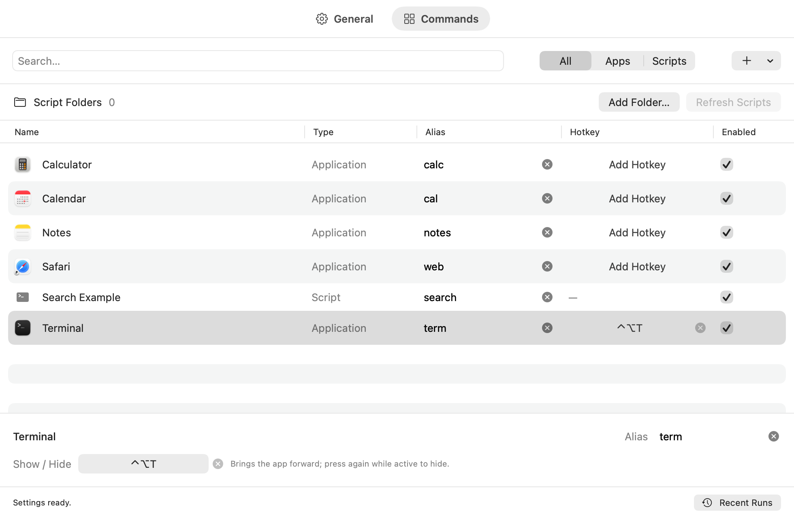

# Uficast

A lightweight, native macOS launcher for applications and local scripts. Built with Swift and AppKit, with no external packages.

**Status:** personal-use feature implementation is available. Automated checks and selected desktop flows pass; remaining hands-on acceptance is tracked in [PROGRESS](docs/plan/PROGRESS.md).

Uficast includes a Day-O-style clock and native calendar in its single menu-bar button.

## Features

- **Cmd+Space launcher** (or another shortcut you choose) with application icons, fuzzy search and aliases that rank first. It opens on the display of the window you are working in.
- **Wrong-layout search** for U.S./Russian keyboards: type `сркщьу` to find Chrome without changing layouts.
- **Calculator**: type a formula such as `24*3+10` or `200+10%` and Enter copies the result. Past calculations appear below as you type or after `calc`, and an unfinished formula is still there when you reopen the launcher.
- **GitHub pull requests**: type `gh`, press Tab, type to filter your open pull requests by title, and press Enter to open one in the browser. It uses the GitHub CLI (`gh`) that is already installed and signed in; Uficast stores no GitHub credentials and no pull request data.
- **Script folders** to discover local shell, Python and AppleScript commands, including Raycast title/argument headers.
- **Local scripts** using shell, AppleScript or another configured interpreter. Pass one unchanged text argument and optionally open a generated URL.
- **Per-app shortcuts** to show, hide or launch an application.
- **Keep Awake** with timed or indefinite sessions, plus optional start at login.
- **AI text**: rewrite copied or selected English into correct, simple English, or translate it between English and Russian, using `claude -p` (Claude Haiku 5.5) or any CLI you configure. The result is shown first, Enter inserts or copies it, and inline formatting is kept.
- **Menu-bar clock and calendar** using the same standard AppKit calendar control as Day-O, with month browsing, Today and customizable format.
- **Caps Lock → F19** remapping for macOS input-source switching, with mapping ownership and keyboard-conflict diagnostics.
- **Native menu bar app** with light/dark appearance, a Settings gear in the launcher and one running instance per user.

No Accessibility or Input Monitoring access is required. The interface is English. Uficast is intended for personal builds on macOS; distribution and notarization are not included.

## Screenshots

These are captures of the actual app views rendered with a fixed demonstration dataset: standard macOS apps and a generic example script. They do not use personal configuration, scan the installed-app catalog or capture the desktop. The shown aliases and shortcut are examples.

**Launcher** — standard apps, aliases and keyboard navigation.


**Commands** — application icons, aliases, enabled state and per-app shortcuts.



**Script argument** — one text input, shown in dark appearance.


**Script failure** — the original input remains available for correction.


## Planning documents

1. [Requirements and interaction details](docs/plan/REQUIREMENTS.md)
2. [Architecture and technical decisions](docs/plan/ARCHITECTURE.md)
3. [Implementation stages and acceptance criteria](docs/plan/IMPLEMENTATION_PLAN.md)
4. [Progress and next-session handoff](docs/plan/PROGRESS.md)

Start each implementation session with `PROGRESS.md`.

## Build and test

Requires macOS 26, Swift 6.2 and Command Line Tools. No external packages.

```sh
scripts/test.sh
scripts/build.sh
open dist/Uficast.app
```

Opening the app shows the launcher immediately. Its gear button opens Settings; **Cmd+,** and **Cmd+P** also open Settings. The menu bar includes the native calendar, **Open Launcher**, **Settings…**, **Date & Time…**, **Keep Awake** and **Quit**. **Retry Shortcut** and application refresh are available in General. The global shortcut uses Carbon registration and never requests Accessibility or Input Monitoring. To use another launcher shortcut, open **General → Launcher**, click **Shortcut** and press the new combination (it must include Command, Control or Option); **Reset** restores Cmd+Space. A combination Uficast cannot register is not saved. Release conflicting shortcuts in Spotlight/Raycast yourself; Uficast does not change their settings. A successful registration does not prove a system shortcut yields the chord.

Build output is `dist/Uficast.app`, locally ad-hoc signed. `scripts/build.sh debug` builds a debug bundle. Optionally set `UFICAST_SIGN_IDENTITY` to an existing signing identity. Quit the running copy before rebuilding or replacing it. Opening a rebuilt bundle while an older copy is still running reveals that existing process; it does not reload its executable. For an isolated build, set `UFICAST_OUTPUT_ROOT` to another output directory. Script Automation consent may need renewal after ad-hoc rebuilds; a stable installation path is recommended.

Read-only diagnostics (no registration or permission prompts):

```sh
dist/Uficast.app/Contents/MacOS/Uficast --diagnostics
```

See [manual verification](docs/MANUAL_TESTS.md). Pure tests and signing checks do not prove real desktop shortcut delivery.

Application discovery uses `/Applications`, `/System/Applications` and `~/Applications`. Use **Refresh Applications** after installing an app; default root changes are also observed. Search supports fuzzy abbreviations and U.S./Russian physical-key alternatives (for example `сркщьу` finds Chrome). Script arguments are never converted. Use Up/Down selection and Enter to launch/activate. Applications and commands you use most come first in the empty search and win ties between equal matches; the counts are remembered locally across restarts (identifiers, counts and dates only). `--catalog-summary` prints a read-only discovery count/timing without launching apps.

## Keyboard shortcuts

These shortcuts work while Uficast has keyboard focus; only the launcher shortcut and assigned app hotkeys are global.

| Shortcut | Action |
| --- | --- |
| Cmd+Space (configurable) | Toggle launcher globally |
| Cmd+, or Cmd+P | Open Settings |
| Esc in Settings | Cancel an inline alias/hotkey edit first; otherwise close Settings (sheets keep their own Cancel action) |
| Cmd+W | Close the current window or launcher |
| Cmd+F | Focus search; in Settings, switch to Commands first |
| Cmd+H / Option+Cmd+H | Hide Uficast / hide other apps |
| Cmd+M | Minimize Settings |
| Cmd+Q | Quit Uficast |
| Cmd+A/C/X/V, Cmd+Z, Shift+Cmd+Z | Standard text editing and undo/redo |
| Tab / Shift+Tab | Native control navigation; Tab in launcher enters the selected script's argument |
| Up/Down, Enter | Select and run a launcher result |

Apple's [standard Mac shortcuts](https://support.apple.com/en-us/102650) use Cmd+, for Settings and Cmd+P for printing. Cmd+P is an owner-requested additional Settings shortcut in Uficast; this app has no print command. Active shortcut recording takes priority over menu shortcuts.

## Settings and aliases

**Settings → General** fits one window without scrolling: two columns of cards (Launcher, Menu Bar Clock, Power & Keyboard, AI Text, Application Folders, Configuration). Most settings are a single row, and the longer explanations are behind the ⓘ buttons. It scrolls only if the window is made very small.

In **Settings… → Commands**, double-click an **Alias** cell (or the alias in the inspector), type a value and press **Enter** to save. **Escape** cancels without saving; click **×** to remove an assigned alias. Invalid or duplicate aliases keep the draft open and show an error. Enabled controls visibility in launcher search. Exact aliases always outrank name/fuzzy matches; enabled commands cannot share an alias. General starts with **Start Uficast at login** and also contains Menu Bar Calendar, Keep Awake, Caps Lock, application roots, refresh, import/export and backup recovery.

In **Settings → Commands**, double-click an application’s **Hotkey** cell (the current shortcut or **Add Hotkey**) to open its inline recorder. A single click only selects the row. **Escape** closes recording without saving and keeps the previous shortcut. Click the **×** beside an assigned shortcut to remove it. You can also select an application and click **Record Hotkey** under **Show / Hide**. Press a combination containing Command, Control or Option; Escape cancels and Delete clears it. Enabled app shortcuts must be unique, and the launcher shortcut (Cmd+Space unless changed) is reserved. The table shows assigned shortcuts and registration errors. If another app claims a chord, release it there first. Script-specific global hotkeys remain deferred.

Private JSON lives in `~/Library/Application Support/Uficast/config.json`, with `config.backup.json`. Saves are atomic. Corrupt/unsupported files are preserved and editing is disabled; explicit backup recovery preserves the replaced file as `config.recovered-<id>.json`. A future schema cannot be overwritten by this older app. Export/import preserves machine-specific paths; locate missing scripts/apps on the new Mac.

## Script commands

In **Settings → Commands**, click **Add Folder…** (also available under **+ → Add Script Folder…**) and choose your scripts directory. Uficast connects the existing files without copying or running them. Use **Refresh Scripts** after adding/removing files; folders are also read on launch. Discovery reads the folder's direct children, skipping hidden files and subfolders.

Supported files: `.sh`, `.bash`, `.zsh`, `.py`, `.applescript`, `.scpt`, and extensionless files with a shebang. The importer prefers the shebang, recognizes standard `/usr/bin/env bash`, `sh`, `zsh` and `python3` forms, and otherwise uses the extension. Executable scripts can retain their own shebang invocation.

Raycast `@raycast.title` and one required text `@raycast.argument1` with its placeholder are read from the comment header. Multiple, optional or non-text argument declarations are reported as unsupported. The default result is **Run for side effects**, suitable for scripts that call `open` themselves. Importing never executes the header or script body.

Existing commands retain their IDs, aliases, enabled state and edited options; the same file is not duplicated. Unavailable folders retain their commands and show a status message. Removed files disappear after refresh. Expand **Connected folders** and click × to disconnect a folder and its managed commands; files remain untouched. Disable a folder-managed command to hide it. Changing its path in the editor detaches that command from folder management.

For individual commands, use **+ → Add Script…**. Choose a local script, set its interpreter (for example `/bin/zsh`, `/bin/bash`, `/usr/bin/osascript`, or `/usr/bin/python3`) and an alias. An empty interpreter runs an executable file using its shebang. Selection offers **Edit…** and **Delete**; deleting a command leaves its source file intact.

For the `k` workflow, configure [browser-search.py](examples/browser-search.py), interpreter `/usr/bin/python3`, alias `k`, one required argument, placeholder `log_stream`, and **Open stdout URL in browser**. In the launcher: `k` → Tab → Cmd+V → Enter. This example generates an encoded example.com URL; it does not contain a real Kibana endpoint. [Shell](examples/echo-argument.sh) and [AppleScript](examples/echo-argument.applescript) examples are also included.

Default result handling runs for side effects and ignores stdout (the script can call `/usr/bin/open` itself). URL mode opens exactly one valid HTTP(S) URL only after exit code zero. Arguments are passed as one argv value; `.zshrc` is not sourced. PATH includes Homebrew and standard system directories; per-command environment overrides are supported. The default working directory is the script folder and the default timeout is 30 seconds.

While a script runs, the launcher stays open with a running status. Success closes it; failure shows the exit/timeout error in the lower section, preferring stderr and falling back to stdout. **Edit Input** restores the exact submitted argument for correction; only an explicit Enter retries. The latest failure and argument stay in memory only. Hiding the launcher for any reason clears its error and remembered input. A late result cannot bring that error back or replace newer input. Each deliberate reopen starts clean.

The **Recent Runs** button in the Settings footer shows active commands, Cancel controls and the ten most recent outcomes in memory. Each command can run once concurrently; different commands can overlap. Output capture is bounded to 1 MiB per stream while both pipes continue draining. Normal quit cancels managed process groups; deliberately detached daemons and force-quit/crash cleanup are outside that guarantee. AppleScript controlling other applications may need **Automation** consent; scripts depending on Accessibility are unsupported under the no-Accessibility requirement.

## GitHub pull requests

Install the [GitHub CLI](https://cli.github.com/) and sign in once (`brew install gh`, then `gh auth login`). In the launcher, type `gh` and press Tab (or Enter): Uficast lists your open pull requests across all repositories, newest first (each row shows the title over the full width with `org/repo #412` below it). Type to filter by title, use Up/Down to select and press Enter to open the pull request in your default browser. Esc, or Backspace in an empty filter, returns to the normal search. Typing `gh` ranks the command first (the alias matches exactly); `g` alone does not match it by alias (it may still appear among the matches by its name, ordered by how often you use each entry). An alias `gh` that you define yourself wins over the built-in command.

The list is loaded by running `gh` the first time, kept in memory for 5 minutes and then loaded again on the next entry; a failure is shown in the launcher and re-entering the mode retries. Limits: the 100 newest open pull requests, `gh`'s default host only (a `GH_HOST` set in a terminal profile is not seen by a GUI app), and `gh` must be on the app's `PATH` or in `/opt/homebrew/bin`, `/usr/local/bin` or the system directories (a `gh` that only a terminal profile adds, such as `~/.local/bin`, counts as not installed). Pull requests in organizations that require SSO authorization of the `gh` token may be missing. No new permission is requested.

## AI text

**General → AI Text** holds the command, two clipboard shortcuts and buttons that create Shortcuts. The default command is:

```sh
claude -p --model claude-haiku-5-5 --tools "" --strict-mcp-config --disable-slash-commands --no-session-persistence --setting-sources project,local
```

The command gets the prompt on stdin and must print only the answer. You can change the model or use another CLI. It runs in your login shell from an empty private folder. The selected text never becomes part of the command line.

- **Clipboard.** Copy text, press **Rewrite from clipboard** or **Translate from clipboard**, and check the result. **Enter** copies it for Cmd+V and **Esc** cancels. This works in any app.
- **Shortcuts.** **Create Rewrite Shortcut** and **Create Translate Shortcut** open a new shortcut in the Shortcuts app, copy a one-line script to the clipboard and list the remaining steps in Settings: name it, use it as a Quick Action, receive Text with Get Clipboard as the fallback, add **Run Shell Script** (input on stdin) with the script, and assign a keyboard shortcut. Use a combination with ⌃⌘⇧ (for example ⌃⌘⇧R): a simpler one may already belong to another app and then silently does nothing. Shortcuts refuses to import generated files ("Importing unsigned shortcut files is not supported"), so the shortcut is built by hand.
  - It takes the selected text where the app offers it as a Quick Action (the Services menu), otherwise the clipboard, and opens `uficast://rewrite?text=…` (or `translate`). The result appears in Uficast and **Enter** copies it; nothing replaces the selection.
  - Some apps, such as many Electron apps and terminals, do not offer their selection, so the clipboard is used there.
  - Any app or web page can open a `uficast://` link. It only starts a request and shows the result; nothing is copied until you press Enter. Text over 20,000 characters is refused.
- **Formatting.** Bold, italics, links and other inline styles are carried through the model with markers and restored. If the model breaks them, the result keeps the selection's main style and the panel says so.
- **Privacy.** The text goes to the program the command runs: Anthropic for `claude`. Uficast stores no text, but that program may keep data under its own settings.

`--verify-ai-text` checks the rich-text bridge, panel and request handling offscreen with a fake command and private pasteboards; it never runs a real AI command.

## Development previews

After a build, these commands render fixture views offscreen without registering shortcuts or modifying user configuration:

```sh
mkdir -p .build/previews
dist/Uficast.app/Contents/MacOS/Uficast --preview-launcher .build/previews/launcher.png
dist/Uficast.app/Contents/MacOS/Uficast --preview-launcher .build/previews/argument.png --argument
dist/Uficast.app/Contents/MacOS/Uficast --preview-settings .build/previews/settings.png
```

Regenerate the README images from these public fixtures:

```sh
scripts/screenshots.sh
# Or pass an isolated build:
# scripts/screenshots.sh .build/readme-app/Uficast.app
```

The preview path does not construct AppController, load personal configuration, register hotkeys, run scripts or change keyboard/login/power settings. It loads icons only from the fixed standard-app paths. Previews verify layout; desktop keyboard delivery, focus, paste and browser behavior require the manual checklist.

## Caps Lock and multiple keyboards

In **General**, enable **Map Caps Lock to F19**. For each keyboard, open macOS **Keyboard → Keyboard Shortcuts → Modifier Keys** and leave the source key as **Caps Lock → Caps Lock**. A system assignment such as Caps Lock → Option or No Action can override the intended source, even when hidutil reports the correct F19 table. Uficast diagnoses conflicting modifier profiles without rewriting them automatically.

Assign **F19** to **Select the previous input source** under macOS **Input Sources**. With two layouts, that switches between them. Keep Uficast running: normal Quit restores its owned mapping; optional start-at-login reapplies the saved preference. Wake and device/service notifications re-publish an owned global table for newly connected keyboard services. Existing identical mappings stay externally managed; competing mappings are preserved and reported. Ownership recovery is local to this Mac and excluded from configuration export.

## Keep Awake

In the launcher, run **caffeine** (or **cafe**) to stay awake until stopped, and **decaffeine** (or **decafe**) to allow idle sleep again. Fuzzy input and U.S./Russian wrong-layout search apply to these commands too. An explicit user alias wins if it reuses a built-in abbreviation; full command names remain searchable. These commands use the same native assertion as the menu and Settings.

Use the menu bar **Keep Awake** toggle or choose **30 Minutes**, **1 Hour**, or **Until Stopped**. General offers the same controls. With the clock enabled, its button opens the calendar and Keep Awake submenu; a `zzz` or cup indicator to the left of the calendar shows the power state, along with the toggle and tooltip. Disabling the clock restores a cup during an active session and a `zzz` sleep icon when off. A native, process-owned IOPM assertion prevents automatic display and system sleep; no `caffeinate` child process or Accessibility permission is used.

The last caffeine/decaf mode is remembered locally and restored on relaunch. Timed sessions resume their remaining time; an already expired session stays off. A fresh installation starts off. Quit releases the process-owned assertion while preserving the remembered mode for the next launch. While active, caffeine keeps the display on during idle use; explicit Sleep, closing the lid, low battery and other macOS sleep reasons still apply. This is the behavior of Apple's [idle-display-sleep assertion](https://developer.apple.com/documentation/iokit/kiopmassertiontypepreventuseridledisplaysleep).

## Menu-bar calendar

The clock is Uficast's one menu-bar button. Click it for a compact native calendar, use its arrows to browse months and the dot to return to today. Each opening starts at today. The menu also offers Open Launcher, Settings, macOS Date & Time, Keep Awake and Quit.

In **Settings → General → Menu Bar Clock**, edit the date format and press Enter or Apply. **Show icon** controls the calendar/day icon beside the text; the `zzz`/cup power indicator stays visible to its left. The default `EEE HH:mm:ss` shows weekday and 24-hour time; `E h:mm:ss a` uses 12-hour time. A preview updates while you edit. Disabling date/time restores the cup/zzz button.

Seconds are scheduled at system-second boundaries, including during menu tracking, and resynchronize after wake or time-zone/clock changes. Calendar browsing uses AppKit NSDatePicker; it does not read calendar events/accounts.

Native development checks (without normal app services):

```sh
dist/Uficast.app/Contents/MacOS/Uficast --verify-menu-clock
dist/Uficast.app/Contents/MacOS/Uficast --preview-calendar /tmp/uficast-calendar.png
```

## Start at login

The **Start at login** checkbox is in the **Launcher** card of **Settings → General**. macOS may require approval in **Login Items**; Uficast shows the actual registered/pending/disabled state. Keep the app at a stable path and recheck registration after moving it. A checked box alone is not evidence of a successful relogin test.

## Native icon regression check

```sh
dist/Uficast.app/Contents/MacOS/Uficast --verify-native-icons
```

This renders 50 AppKit launcher cells offscreen and verifies that background icon loading delivers real bitmaps without moving rows or the scroll position. It registers no hotkeys and changes no personal configuration. Development previews also support `--dark`, Settings `--general`, and `--preview-script-editor <output.png>`.

The native `--verify-shortcut-recorder` development check exercises double-click entry, Escape without saving, valid capture, explicit clear and focus/window/cell cleanup using in-memory Settings fixtures. It does not register global shortcuts or load personal configuration.

The native `--verify-alias-editor` and `--verify-script-feedback` checks cover transactional alias edits and failure/retry presentation with public in-memory fixtures. Argument previews accept `--empty-argument` and `--failure` in addition to `--argument` / `--dark`.
